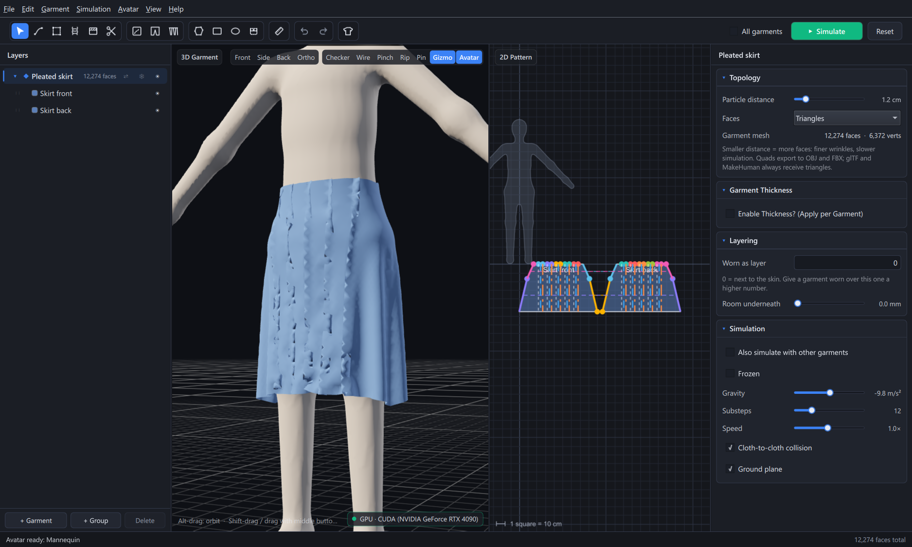
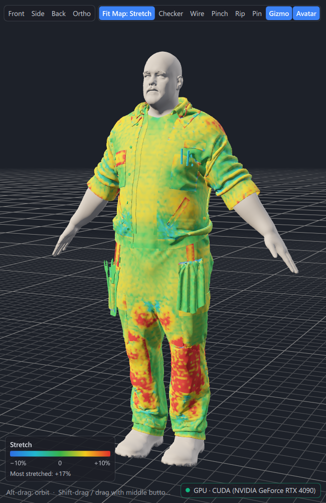

# Seamstress User Guide

Seamstress is a garment creation tool. You draw flat pattern pieces, sew their edges together, place them around
an avatar and let a cloth simulation drape them. The result can be exported as OBJ, glTF or FBX, or sent straight
into MakeHuman's clothes library.

This guide covers everything the application does. If you are coming from Marvelous Designer or CLO, start with
[Getting started](#getting-started) and keep [Coming from Marvelous Designer](#coming-from-marvelous-designer)
open next to it.

**Contents**

1. [Getting started](#getting-started)
2. [The window](#the-window)
3. [Coming from Marvelous Designer](#coming-from-marvelous-designer)
4. [The 2D pattern view](#the-2d-pattern-view)
5. [Sewing](#sewing)
6. [The 3D view](#the-3d-view)
7. [Simulation](#simulation)
8. [Layers](#layers)
9. [Properties](#properties)
10. [Topology: face count, triangles and quads](#topology-face-count-triangles-and-quads)
11. [Materials, UVs and texel density](#materials-uvs-and-texel-density)
12. [Avatars](#avatars)
13. [Saving and the project file](#saving-and-the-project-file)
14. [Exporting](#exporting)
15. [Send to MakeHuman](#send-to-makehuman)
16. [Preferences](#preferences)
17. [Working with an AI agent](#working-with-an-ai-agent)
18. [Keyboard and mouse reference](#keyboard-and-mouse-reference)
19. [Troubleshooting](#troubleshooting)

---

## Getting started

This walk-through makes a T-shirt in about a minute, using one of the built-in garments so you can see every
stage before drawing your own.

### 1. Add a garment

Choose **Garment ▸ Add T-Shirt**. Four pattern pieces appear in the 2D view on the right, already sewn
together. In the 3D view on the left the same pieces stand flat around the avatar. The red lines between them are
the sewing threads: each one joins two points that will be stitched together.


### 2. Simulate

Press **Simulate** (or the Space bar). The pieces are pulled together along their seams, then gravity takes
over and the shirt settles on the body. Press **Simulate** again to stop.


Simulating is one undo step: **Ctrl+Z** puts the pieces back where they were. **Reset** (next to Simulate)
returns them to their flat arrangement at any time.

### 3. Change something and simulate again

- Click a piece in either view to select it. Its settings appear in the **Properties** panel on the right.
- Under **Fabric Physics**, pick another **Preset** (try *Silk* or *Denim*) and simulate again to see the
  difference.
- Under **Topology**, drag **Particle distance** to the left for more faces and finer wrinkles, or to the right
  for fewer.

### 4. Save or export

- **File ▸ Save** writes a `.garment.json` project you can reopen later.
- **File ▸ Export** writes OBJ, glTF or FBX for other applications.

From here, the rest of this guide explains each area in detail, including how to draw and sew your own pieces.

---

## The window


| # | Area | What you do there |
| --- | --- | --- |
| 1 | **Menu bar** | Files, export, edit commands, ready-made garments, avatar choice, view options. |
| 2 | **Tools** | Pick what the mouse does in the 2D view; undo and redo; switch the 2D view between pattern and UV layout. |
| 3 | **Simulation controls** | **Simulate** starts and stops the cloth simulation. **All garments** widens it from the active garment to every visible one. **Reset** returns pieces to their flat arrangement. |
| 4 | **Layers** | Every garment, the groups inside it and its pieces. Select, rename, hide, group, delete. |
| 5 | **3D Garment view** | The avatar and the garments on it. Alt-drag to orbit around, select pieces, move and rotate them with the handles. |
| 6 | **2D Pattern view** | Where pieces are drawn, shaped and sewn. Also shows the UV layout. |
| 7 | **Properties** | Settings of whatever is selected: topology, 3D arrangement, fabric physics, material, UVs, seams, simulation. |
| 8 | **Status bar** | Hints for the current tool, simulation progress, and the total face count. |

The borders between the panels can be dragged to resize them.

### The tools

The toolbar shows each tool as an icon. Hover over an icon to see its name, what it does and its key.


| # | Tool | Key | What it does |
| --- | --- | --- | --- |
| 1 | **Select** | V | Click a piece to select it, drag to move it in the pattern. Ctrl+click adds to the selection. Drag a box from empty space to select every piece it touches (hold Shift or Ctrl to add to the selection). Click a seam's dashed line to select the seam. Double-click a piece to select all its points. |
| 2 | **Edit Points** | A | Drag a point to move it. Drag an edge to curve it. Double-click an edge to add a point. |
| 3 | **Transform Points** | T | Select one point or several, then move or rotate them with handles. Does not bend edges. |
| 4 | **Sew** | S | Click one edge, then another, to sew them together, or drag a box around several edges and press Enter. |
| 5 | **Inset Band** | I | Cut a waistband, collar band or facing off pieces along the edges you click, already sewn on (see [Cutting bands from edges](#cutting-bands-from-edges)). |
| 6 | **Cut** | C | Drag a line across pieces to cut them into separate pieces (see [Cutting pieces apart](#cutting-pieces-apart)). |
| | **Internal Line** | L | Draw a line inside a piece for the cloth to follow; with a fold angle it is a fold line (see [Fold lines, darts and pleats](#fold-lines-darts-and-pleats)). |
| | **Dart** | D | Click a dart's point inside a piece, then its two leg ends on an edge: the wedge is cut out and the legs sewn together. |
| | **Pleat** | Y | Drag along an edge to pleat that stretch with knife pleats, tacked at the edge. |
| 7 | **Polygon** | P | Click to place corners; click the first corner again, double-click, or press Enter to finish. |
| 8 | **Rectangle** | B | Drag out a rectangular piece. |
| 9 | **Ellipse** | O | Drag out an elliptical piece. |
| | **Trim** | J | Drag on a piece to add a pocket, flap or patch, or click to set a snap, button, rivet or buckle (see [Pockets, patches and hardware](#pockets-patches-and-hardware)). |
| 10 | **Ruler** | M | Measure a distance in the 2D view, or between two points on the cloth or avatar in the 3D view (see [Measuring with the Ruler](#measuring-with-the-ruler)). |
| 11 | Undo | Ctrl+Z | Undo the last change. Hover to see what it will undo. |
| 12 | Redo | Ctrl+Shift+Z | Redo. |
| 13 | **Pattern / UV Layout** | U | Switch the 2D view between the pattern and the UV layout. |

The keys are the defaults; every one of them can be changed in [Preferences ▸ Keyboard](#keyboard-shortcuts).

**Right-click** in the 2D or 3D view opens the **Edit** menu, with each command's key on the right. The piece
under the pointer is selected first, unless it is already part of the selection, so the menu acts on what you
clicked. Dragging with the right button still pans.


---

## Coming from Marvelous Designer

The workflow is the same: draw patterns in 2D, sew them, arrange them around the avatar, simulate. The table
maps what you already know to where it lives here.

| In Marvelous Designer | In Seamstress |
| --- | --- |
| 2D Pattern window | **2D Pattern view** (right) |
| 3D Garment window | **3D Garment view** (left) |
| Object Browser / Scene | **Layers** panel |
| Property Editor | **Properties** panel |
| Polygon, Rectangle, Ellipse tools | The same three tools, keys **P**, **B**, **O** |
| Transform Pattern | **Select** tool (**V**): drag a piece. Rotate and mirror are in the **Edit** menu |
| Edit Pattern (move points and lines) | **Edit Points** tool (**A**): drag a point |
| Selecting several points and moving or rotating them | **Transform Points** tool (**T**) |
| Edit Curvature | **Edit Points** tool: drag an edge to bend it |
| Add Point / Split Line | **Edit Points** tool: double-click an edge |
| Internal shape ▸ Cut / Convert to Hole | **Cut** (**C**) splits pieces along a drawn line; for a hole, draw the shape as a piece on top, select both, **Edit ▸ Cut Hole** |
| Offset as Internal Line, then Cut & Sew (for a waistband or facing) | **Inset Band** tool (**I**): click the edges, set the width, Apply |
| Internal Line, with Fold Angle and Fold Strength | **Internal Line** tool (**L**), with the fold angle and strength in its panel |
| Dart | **Dart** tool (**D**): the point, then both leg ends on the edge |
| Pleat (Knife) | **Pleat** tool (**Y**): drag along the edge, count and depth in its panel |
| Segment Sewing | **Sew** tool (**S**): click one edge, then the other |
| Edit Sewing ▸ reverse a twisted seam | Select the seam, then **Reverse Direction** in Properties |
| Simulate (Space) | **Simulate** (Space) |
| Reset 3D Arrangement | **Reset** button, or **Simulation ▸ Reset Arrangement** |
| Gizmo | The arrows and rings on the selected piece in the 3D view |
| Dragging the cloth while simulating | **Pinch** (**G**) in the 3D view; it also works after the simulation has stopped. **Rip** (**X**) tears the cloth along a dragged stroke |
| Pockets, flaps, patches, buttons and snaps | **Trim** tool (**J**): drag on a draped piece, then simulate |
| Avatar-fitted blocks | **Garment ▸ Add Fitted Tee / Trousers / Jacket / Hoodie…**: cut to the avatar, with fit, length, sleeves and an open front |
| Collars and hoods | **Garment ▸ Add Collar…** and **Add Hood…** on a fitted top |
| Arrangement points | Not available. Place pieces with the gizmo or the numbers under **3D Arrangement**; **Wrap** curls a piece around an arm or leg |
| Particle Distance | **Topology ▸ Particle distance** (per garment, with a per-piece override) |
| Mesh type: Triangle / Quad | **Topology ▸ Faces**: Triangles or Quads |
| Fabric physical property presets | **Fabric Physics ▸ Preset** |
| Fabric (texture, colour) | **Material** section |
| UV Editor | **Pattern / UV Layout** toggle (**U**) |
| Freeze / deactivate a garment | **❄** (Freeze: holds still, still collided with) and **⊘** (Deactivate: left out of the simulation, other cloth passes through) on the garment's row in Layers |
| Particle distance 20 mm while building, then refine | **Draft \| Final** switch beside Simulate; **Refine to Final** keeps the drape and pins |
| Layers (which garment is on top) | Order of simulation: simulate the inner garment first, then the outer one |
| Avatar | **Avatar** menu: built-in mannequin, MakeHuman base mesh, or your own OBJ |
| Export OBJ / FBX / glTF | **File ▸ Export** |

### Differences to be aware of

- **Garments are separate objects.** A project holds any number of garments (a shirt, a skirt). The one you
  last clicked is the *active* garment, shown highlighted in Layers, and Simulate only affects that one.
- **A seam joins a whole edge to a whole edge.** To sew part of an edge, split it first by double-clicking
  it with the Edit Points tool; each part is then its own edge.
- **Units.** Patterns are in centimetres; 3D positions are in metres. To work in inches instead, switch
  **Measurements** to Imperial in [Preferences](#preferences).
- **Not available yet:** internal lines and darts, seam allowance, linked symmetric patterns, trims
  (buttons, zippers), pressure and wind, animation, and avatar posing or measurement editing.

---

## The 2D pattern view

The 2D view is where garments are designed. The cursor position is shown in the bottom-right corner.

**The grid** gets finer as you zoom in. The scale bar in the bottom-left corner is the width of one grid
square and says how big it is: 1 mm, 1 cm, 10 cm, 1 m or 10 m in metric, and 1/8 in, 1 in, 4 in, 1 ft or 1 yd
in imperial. Every few squares there is a stronger line (every tenth square in metric).

**Moving around:** scroll to zoom about the cursor; drag with the middle or right mouse button (or
Alt+left-drag) to pan; Alt+right-drag also zooms; press **F** to frame everything. A right-click without dragging opens the Edit menu.

**The body** is drawn faintly behind the pieces: a front view of the same avatar you see in 3D (the mannequin
or a MakeHuman mesh), at its true size, standing on the origin, so you can see where the pattern falls on the
body without the body getting in the way. It follows the avatar: switching base mesh under **Avatar** or
changing the body shape redraws it. **View ▸ 2D: Show Avatar** turns it off and on.


### Reference images

**View ▸ References ▸ Add Reference Image…** places a photo or a scanned pattern guide behind the pattern.
PNG, JPEG, GIF, BMP and WebP images can be used. References are drawn under the avatar outline and the
pieces, so they never hide the garment; lower their **Opacity** in Properties to trace over them more easily.

- With the **Select** tool, click a reference where no piece is in the way to select it, then drag the picture
  to move it. **View ▸ References** selects one from the list too, whatever the current tool.
- Drag a corner handle to resize it evenly; the round handle above the top edge turns it. Hold **Shift** while
  moving to snap its centre to the grid, while resizing for steps of a tenth, or while turning for 15° steps.
- The Properties panel shows its file, position, width, height, rotation and opacity, and has a **Remove
  Reference** button. **Delete** removes the selected reference too.
- **Lock Reference** in Properties holds a picture in place: it can no longer be clicked, moved, resized,
  turned or deleted in the view. Choose it from **View ▸ References** to reach it, then untick **Lock
  Reference** to edit or remove it. Opacity and visibility can still be changed while it is locked.
- **View ▸ References** lists every picture, marks hidden and missing ones, and has **Remove All References**.
  Untick **Show References** there to hide all of them while working on the pattern.
- The image file is linked, not copied into the project. Saving keeps a path relative to the project file when
  the picture is in the same folder or below it; moving or deleting the file later leaves the reference in the
  project with a warning in Properties.

References are only part of the 2D pattern view: they are not shown in the UV layout or the 3D view, and they
are not exported.

### Drawing pieces

New pieces go into the active garment. If there is none, one is created.

- **Rectangle** and **Ellipse**: drag from one corner to the opposite corner. Hold **Shift** for a square or
  a circle.
- **Polygon**: click each corner in turn. Finish by clicking the first corner again, double-clicking, or
  pressing **Enter**. **Esc** abandons the shape. Hold **Shift** to constrain the side you are placing: its
  angle snaps to 15° steps and its length to a whole centimetre (or quarter inch). Shift applies side by
  side, so you can hold it for one side and let go for the next.

While you draw, each side shows its length; a rectangle shows its width and height and an ellipse its size
across. Shift can be pressed or released in the middle of a drag.

### Moving, rotating and scaling pieces in 2D

With the **Select** tool, a selected piece shows the same handles as the 3D view (see
[Choosing which handles are shown](#choosing-which-handles-are-shown)). The arrows move the piece along one
axis, the ring turns it, and the boxes scale it: red for width, green for height, yellow for both. Hold
**Shift** while turning for 15° steps and while scaling for steps of a tenth, or while moving to snap the
piece's position to the grid. You can still drag the piece itself to move it freely.

### Measuring edges


Click an edge with the **Select** or **Edit Points** tool to see how long it is, straight or curved, in the
units chosen in Preferences. Clicking a little outside the piece is close enough. The label follows the edge
while you bend it, and dragging a point shows the two edges that meet there. With the **Sew** tool the edge
under the cursor and the first edge you picked show their lengths, and a selected seam shows both of its
edges, which makes it easy to see whether the two sides match.

A new piece takes the material and fabric of the garment's first piece, and is placed in front of the avatar's
chest in 3D.

### Measuring with the Ruler


Pick the **Ruler** (**M**).

- **In the 2D view**, drag from one place to another. The line shows a tick at every grid square, and the label
  gives the distance and its angle. An end that comes near a pattern point catches on it, so measuring from
  corner to corner is exact. Hold **Shift** to keep the line to 15° steps.
- **In the 3D view**, click a point on the cloth or the avatar, then click a second one; the far end follows the
  pointer until you do. You can also drag from the first point to the second. The distance is straight across,
  not along the surface. Alt+dragging (or Ctrl+dragging) from empty space still orbits the camera.

The ruler stays until you measure again, click empty space, press **Esc**, or pick another tool. It never
changes the pattern.

### Shaping pieces

Switch to **Edit Points** (**A**) and click a piece. Its corner points appear as white squares; curved edges
also show a yellow handle.


| To                               | Do this                                                               |
| -------------------------------- | --------------------------------------------------------------------- |
| Move a point                     | Drag a white square                                                   |
| Put a point on the grid          | Hold **Shift** while dragging it (or its yellow handle)               |
| Curve an edge                    | Drag anywhere along the edge; the curve follows the cursor            |
| Adjust a curve                   | Drag its yellow handle                                                |
| Add a point                      | Double-click the edge where you want it                               |
| Remove a point                   | Click it, then press **Delete** (a piece keeps at least three points) |
| Make curved edges straight again | **Edit ▸ Straighten Curved Edges**                                    |

With **Shift** held, the point snaps to the nearest crossing of the smallest squares on screen, so the step
follows the zoom: zoom in for finer steps (down to 1 mm, or 1/8 in in imperial) and out for coarser ones. The
same snapping moves points in **Transform Points** and pieces in **Select**. The scale bar in the corner says
how big a square is.

### Arranging pieces in the pattern

With the **Select** tool (**V**), drag pieces to lay them out. This only changes the 2D layout (and therefore
the UVs), not the 3D placement. The **Edit** menu also has **Duplicate** (Ctrl+D), **Mirror Piece**, and
**Rotate 90° Left / Right**. Seams stay attached to the right edges when you mirror, add or remove points.

### Moving and rotating several points


**Transform Points** (**T**) works on points rather than whole pieces.

- **Scale:** with two or more points selected, drag a box to scale them about their middle: red for width,
  green for height, yellow for both. **Q / W / E / R** choose which handles are shown.

- **Select:** click a point; **Ctrl+click** adds or removes one; drag a box over empty space
  to select every point inside it, across pieces. **Ctrl+A** selects every point of the active garment.
  Click empty space to clear the selection.
- **Select a whole shape:** double-click inside a piece. This works from the **Select** and **Edit Points**
  tools too, and switches to Transform Points with every point of that piece selected, ready to move, turn
  or scale. **Ctrl+double-click** adds another piece's points to the selection. (In Edit Points, a double-click
  on an edge still adds a point there.)
- **Move:** handles appear in the middle of the selected points. Drag the red arrow to move them left–right
  only, the green arrow up–down only, or the white square to move them freely. You can also just drag any
  selected point. Hold **Shift** to snap the points to the grid (use an arrow to keep to one axis).
- **Rotate:** with two or more points selected, drag the blue ring to turn them about their middle. Hold
  **Shift** for 15° steps.
- **Delete** removes the selected points (a piece always keeps at least three). Selecting every point of a
  hole and pressing **Delete** removes the hole.

A curved edge keeps its shape when both of its ends are selected: the curve moves and turns with them. If
only one end is selected, the curve handle stays where it is.

This tool never bends an edge. To curve the edge between two points, switch back to **Edit Points** (**A**)
and drag the edge.

### Cutting holes

A hole is cut in the shape of another piece: draw the shape on top of the piece to cut (with Polygon,
Rectangle or Ellipse, or move an existing piece there), select both (click one, **Ctrl+click** the other), then
right-click and choose **Cut Hole** (also in the **Edit** menu).


- The piece the other one lies inside gets the hole. The shape must lie entirely inside it, without touching
  its edges or a hole it already has. With several shapes selected inside one piece, each cuts its own hole.
- What was cut out becomes a new piece, **"… cut-out"**, of the same fabric. It is laid out beside the cut
  piece in the pattern and placed in 3D just behind the hole. The piece you drew the shape with is left as it
  is, so either one can become the pocket bag, facing or patch; delete the other if you don't need it.
- A draped piece stays draped when it is cut, and the cut-out starts draped the same way.
- A hole's edges can be sewn like any other edge. For a pocket, sew the cut-out (or the shape you cut with) to
  three sides of the hole and leave the fourth open. The hole runs the opposite way round the shape, so a seam
  between matching edges starts out untwisted.
- **Edit Points** and **Transform Points** work on a hole's points as on the outline's: drag them, add points by
  double-clicking a hole edge, and **Delete** them. A hole needs at least three points, so deleting one of the
  last three removes the hole, and so does selecting all of its points and pressing **Delete**. **Ctrl+Z**
  brings it back.
- In the 2D view you see through a hole to the grid and to any piece beneath it, and a click there selects
  what is underneath.

### Cutting bands from edges

A waistband, collar band, neckband or facing has to match the edge it is sewn to exactly. Instead of drawing it
as a separate piece, cut it off the piece itself: pick **Inset Band** (**I**), click the edges, set the width and
press **Apply**.


1. **Click the edges** the band runs along: the waist of the front, say, and the waist of the back. Edges of
   several pieces can be chosen at once. Click a chosen edge again to drop it; click empty space to start over.
2. **Set the width.** Drag inward from a chosen edge, or use the Width box in the panel in the top-right corner of
   the 2D view: type a number, or drag left or right in the box. Hold **Shift** while dragging an edge for whole
   centimetres (or quarter inches). Each band is previewed as you go, shaded, with its cut line dashed.
3. **Apply** (or press **Enter**). **Esc** or **Cancel** drops the choice without cutting anything.

What you get:

- Each piece is cut along the dashed line. What was beyond it becomes a new piece, **"… band"**, of the same fabric.
  It is left exactly where it was cut, in the pattern and in 3D, so you see the cut; drag it aside in the pattern
  if you like. A draped piece stays draped, and so does its band.
- **The band is sewn to the piece** along the cut, so you can simulate straight away.
- **Seams carry over.** A seam on a chosen edge moves to the band. A seam on an edge the cut runs into (a side
  seam, say) is split in two, so the band and the piece both stay sewn: cut the front and back waists together and
  the side seams continue up the waistband. If the edge it is sewn to was not cut at the same place, a point is
  added to it there.
- **Edges next to each other make one band**, turning the corner; edges apart make one band each. Choosing every
  edge of an outline or of a hole gives a ring.
- **Curved edges work too.** The band's outer edge is the original curve, unchanged, and the cut follows it at the
  chosen width, so a band cut from a neckline or a curved waist is contoured to fit it. Where the edge next to a
  band is curved, it is split where the cut meets it and both parts keep its shape.
- **Ctrl+Z** undoes the whole cut in one step.

The width has to fit. When it does not, the preview turns red, the panel says why and **Apply** is unavailable:
the cut would cross another edge or a hole, it would run past the end of the edge beside the band, or a curve
bulges more tightly than the band is wide.

### Cutting pieces apart

Use **Cut** (**C**) to split one or more pieces with a straight line:

1. Pick **Cut** and drag a line across the pieces you want to divide. Hold **Shift** to keep the line to 15° steps.
2. Release the mouse button. Every visible piece the line crosses is cut into separate pieces.


The cut keeps curves, holes and the fabric settings. Pieces stay where they were in the pattern and in 3D, and
draped pieces stay draped. Seams on edges that the cut does not divide stay sewn; a seam on an edge that is
divided is removed, because that edge is no longer one edge.

A line that does not divide a piece into at least two pieces does nothing; the status bar says why. **Ctrl+Z**
undoes the cut in one step.

### Fold lines, darts and pleats

Three tools add shape inside a piece rather than at its edges. Each one is a single undo step, and all of them are
saved with the project.



**Internal lines and fold lines.** Pick **Internal Line** (**L**) and click inside a piece to start a line. Each
click adds a point; drag while clicking to bend the stretch to that point into a curve. Double-click, press
**Enter** or click on the piece's outline to finish. A click near the outline catches on it, so a line can run from
edge to edge. The cloth's mesh always has edges along the line.

With a **Fold angle** above 0 in the tool's panel, the line is a fold line. The cloth folds there when simulated, and
stays folded: use it for a pressed crease, a turned-back cuff or a lapel's roll line. 90° is a right angle; 180° folds
the cloth right back onto itself. A **mountain** fold (the default) makes a ridge on the outside of the garment; tick
**Valley fold** for a groove instead. **Strength** is how firmly the fold holds its angle. In the 2D view plain lines
are finely dashed, mountain folds are orange and valley folds are blue.

To change a line later, click it with the Internal Line tool: the panel then shows and edits that line, and
**Delete** removes it.

**Darts.** Pick **Dart** (**D**), click where the point of the dart goes inside a piece, then click the two places
on one edge where its legs end. The wedge between them is cut out of the piece and its two legs are sewn together, so
the flat cloth takes a cone shape around the point: over the bust, the waist, the hips or the shoulder blades. The
edge is split where the legs meet it. A seam on that edge is taken off, because it would now only cover part of it;
sew the new edges again.

**Pleats.** Pick **Pleat** (**Y**) and drag along an edge over the stretch you want pleated. The tool's panel sets how
many pleats there are, how deep each one is (how much cloth it folds under) and how far down they are **stitched**;
pulling the pointer into the piece while you drag sets the depth too. The preview shows the folds before you let go.
Each pleat is a knife pleat: a mountain fold and a valley fold running straight across the piece from the edge, its
top sewn shut, so the edge comes in by twice the depth for each pleat. Each fold is also stitched onto the cloth it
lies on, 8 cm down from the edge unless you change it; below that the pleats open and swing. The stitching is what
carries a pleated skirt: set it to 0 and the pleats are only tacked along the edge, and the garment then needs a
waistband to stay up. Pleat a skirt panel's waist before sewing it at the sides: the waist must still fit the body
once the pleats take it in.

A flat pleated piece starts its simulation already folded, so its stitching begins closed. Pleats drape with or
without **Cloth-to-cloth collision**; the layers of one pleat are folded against each other on purpose, so they do
not collide with each other.

---

## Fitted garments, collars and hoods

**Garment ▸ Add Fitted Tee, Fitted Trousers, Fitted Jacket** and **Fitted Hoodie** cut the garment to the
avatar's own measurements and place it round the body, sewn and ready to simulate. A dialog asks first:

- **Fit**: from close fitting to roomy.
- **Body length** or **Leg length**: longer or shorter than measured. Extra trouser length stacks in folds on the
  shoes.
- **Sleeves** (tops): none, short or long.
- **Front** (jacket and hoodie): open, with the gap between the fronts. **Hood** (hoodie): with or without.
- **Side seam back** and **Hem opening** (trousers): move the side seam towards the back so pockets sit on the side
  of the leg; narrow the hems (keep them wider than the shoes).

Add garments from the skin outwards: each one is put on a layer over what is already worn, with room for it.

**Garment ▸ Add Collar…** sews a band round the neckline of a fitted top: a **stand collar**, a **gathered cowl**,
or a **hood pushed down** into a padded roll round the neck. **Add Hood…** sews a hood that lies down the back;
tick *Only round the back of the neck* when a jacket collar is worn over it. Both work on the active garment, or
on the outermost fitted top when the active garment has no neckline (right after adding a collar, for example).
Simulate the new garment to sew it on.

## Pockets, patches and hardware

Pick **Trim** (**J**), or **Garment ▸ Add Pockets, Patches and Hardware**. A bar at the top of the 2D view chooses
what to add:

- **Pocket** (open at the top), **Flap** (sewn along the top, lying over what is under it) or **Patch** (sewn all
  round): drag a rectangle on a piece in the 2D view to place and size it, or click for one of the usual size. A
  faint rectangle follows the pointer to show where a click puts it.
- **Snap**, **Button**, **Rivet** or **Buckle**: click on a piece to set it there. Hard parts are pinned, so
  simulating never moves them.

Sewn trim goes into its own garment one layer out from the piece it is on (a flap one layer further, so it lies
over a pocket), placed on the cloth where the piece hangs now. Simulate that garment to sew it on. Trim lands
best on a garment that has already been simulated. Each addition is one undo step.

## Sewing

Pick the **Sew** tool (**S**), click one edge, then click the edge to sew it to. The first edge stays
highlighted until you click the second; **Esc** cancels. Both edges must belong to the same garment. An edge
may be sewn to an edge of the same piece (the underarm seam of a sleeve, for example).

To sew several edges at once, **drag a box around them** on empty space. The chosen edges stay highlighted;
press **Enter** and the closest pairs are sewn automatically, trying both directions along each edge so a
twisted seam is avoided. Hold **Ctrl** while dragging to add another box to the selection. This is handy after a
cut leaves a row of short edges that need to be sewn back together. Edges that are already sewn, or that are
left without a partner, are skipped.


Each seam is drawn with:

- the **two sewn edges in the same colour**,
- a **dashed line** joining them (click it to select the seam),
- a **dot on each edge marking the ends that meet**. If the dots are at opposite ends from what you intended,
  the seam is twisted.

Selecting a seam shows it in Properties:


- **From / To** name the two edges and **Lengths** shows how long each is. Edges of different length can be sewn;
  the longer one is eased onto the shorter.
- **Reverse Direction** swaps which ends meet, which fixes a twisted seam.
- **Delete Seam** removes it (so does the **Delete** key).

In the 3D view, seams that are not yet closed appear as red threads between the pieces. They disappear as
simulation pulls each stitch shut.

**Surface stitches** sew an edge of one piece onto a line *inside* another piece instead of onto an edge: a
patch pocket, a flap, a knee pad, a belt loop. They are made through the MCP server or by editing the project
file (`surfaceStitches`); the interface shows them but has no tool to draw them yet. In the 2D view each one is
drawn in its own colour: the **patch's edge highlighted**, the **line it is sewn onto dashed on the host piece**,
a dotted thread joining the two, and a dot (on the edge) and a ring (on the line) at the ends that meet. In the
3D view, stitches that are not closed yet appear as amber threads when **View ▸ 3D: Show Sewing Threads** is on.

---

## The 3D view

**Moving around**

| To | Do this |
| --- | --- |
| Orbit | Alt+drag with the left mouse button (Ctrl+drag also works) |
| Pan | Shift+drag, or drag with the middle or right button |
| Zoom | Scroll, or Alt+drag with the right button |
| Select a piece | Click it (Ctrl+click adds to the selection). Click empty space to deselect |
| Edit menu | Right-click without dragging |
| Front / side / back | **1** / **3** / **Ctrl+1** (on the number row or the keypad) |
| Orthographic on or off | **5** (number row or keypad), or the **Ortho** button |

### View buttons


| # | Button | What it does |
| --- | --- | --- |
| 1–3 | **Front / Side / Back** | Jump to a standard camera angle. |
| 4 | **Ortho** | Switch between a perspective and an orthographic camera (see below). |
| 5 | **Checker** | Replace fabric colours with a checker texture, to judge UVs and texel density. |
| 6 | **Wire** | Draw the outline of every face, to see the topology. (**View ▸ 3D: Normal Direction**, which has no button, colours the front and back of the faces; see [Normal direction](#normal-direction).) |
| 7 | **Pinch** | Drag the cloth itself to tug it into place (see [Pinching the cloth](#pinching-the-cloth)). |
| 8 | **Rip** | Drag across the cloth to tear it (see [Ripping the cloth](#ripping-the-cloth)). |
| 9 | **Gizmo** | Show or hide the move, rotate and scale handles. **Q / W / E / R** choose which of them are shown. |
| 10 | **Avatar** | Show or hide the avatar. Hidden, it still collides with the cloth. |

Left of **Checker**, the **Fit Map** button colours the cloth by how it fits: see [Fit maps](#fit-maps).

**Orthographic view.** With **Ortho** on (or **5**, or **View ▸ 3D: Orthographic**) the camera has no
perspective: things further away are not drawn smaller, so the two sides of a garment, or a sleeve and the
body, can be compared by eye. Together with **Front** and **Side** it gives flat, technical-drawing views.
Orbiting, panning, zooming, the handles, Pinch, Rip and the Ruler all work the same in both cameras.

### Normal direction

Every face of a piece has a front and a back; its **normal** points out of the front. Game engines and other
3D programs often draw only the front of a face, or light it from that side, so a garment exported with some
pieces facing inwards can show holes or dark patches there.


Turn on **View ▸ 3D: Normal Direction** to colour every piece by the side you are looking at: **blue** is the
front, **red** the back. On a finished garment the outside should be blue all over. A piece that shows red
from outside faces the wrong way: select it and press **Invert Normals** under **3D Arrangement** in
Properties (also in the Edit menu and the right-click menu). This turns its faces round without changing its
shape, its drape or the simulation, and it is one undo step. With several pieces selected each one is turned
round, and Properties shows how many of them are inverted. The setting is saved with the project and applies
to every export: OBJ, glTF, FBX and Send to MakeHuman.

### Fit maps

Click **Fit Map** in the 3D view and choose a map to colour the cloth by how it fits, the way Marvelous Designer's
fit maps do. The colours follow the cloth live while it simulates, so you can watch a tight spot appear as a garment
settles, pinch it, or change the pattern and simulate again. A key in the bottom left corner shows the colours and
the worst value on screen, leaving out the most extreme 1% of the cloth (a single pinched corner would otherwise
stand for the whole garment). Choose **Off** to see the fabric again.



| Map | What it shows |
| --- | --- |
| **Stretch** | How much longer or shorter the cloth is than its pattern, after the fabric's **Elastic** (shrink) settings. **Green** is at rest, **yellow** about 5% stretched and **red** 10% or more; **blue** is compressed by 10% or more, where the cloth is pushed together and usually folds. |
| **Pressure** | How hard the cloth presses on the body. Cloth that does not touch is **grey**; cloth that touches but is slack is **green**; it turns **yellow**, **orange** and **red** the more it is stretched where it touches, as a tight band presses harder than a loose one. Red areas are where a garment would feel tight. |
| **Distance to body** | How much air is under the cloth, in centimetres: **red** touching, **yellow** about 1 cm, **green** 2.5 cm and **blue** 5 cm or more. It is measured beyond the room the garment keeps for itself, its thickness and **Room underneath**, so a jacket worn over a tee shows red where it lies on the tee. |

Hidden pieces and garments are left out, and the maps measure the cloth against the avatar as it is now. The same
numbers are available to agents through the `fit_map` tool (see [MCP](MCP.md)).

**Easing tight spots.** Where the stretch map shows a garment pulled tight because its pattern is too narrow, choose
**Fit Map ▸ Ease Tight Spots…**. It measures how much the active garment's cloth is stretched across each piece (along
the pattern's width) in rows a few centimetres high, and lets each row out by part of what it would take for the cloth
to sit at **Stretch that is fine** (2% to start with). Only the tight rows grow, smoothly, so a tight knee gets room at
the knee and the hip stays as it was. The dialog lists what will change before anything does. **Ease and Simulate**
changes the pattern as one undo step, keeps the cloth draped where it was and simulates again so it relaxes into the
new pattern; repeat while red is left. **Correction per pass** below 100% keeps each step small, so the passes settle
instead of overshooting.

- Only stretch *across* a piece is eased. Stretch along it is left alone, since lengthening a piece moves its hem and
  the seams at its ends; the `ease_pattern` tool reports it.
- Pieces that pull in on purpose (**Elastic across** below 1: waistbands, cuffs) and hard parts pinned all over are
  left alone. Patches sewn onto an eased piece, hard parts attached to it and its pins keep their place on its cloth.
- **Set creases** on an eased piece are cleared: they hold the cloth at the shape it had when they were set, which is
  the stretch being eased out. Set them again once the cloth has relaxed. If the stretch map shows red on a creased
  garment, try **Clear Creases** first: on Gus's trousers the red came from creases set on stretched cloth, not from
  the pattern.
- A seam whose two edges now differ in length (an eased piece sewn to one that was not) is eased in when sewn; the
  dialog says when that is a centimetre or more, and you can let the other side out too.
- Easing widens rows; it cannot add the shape a dart gives. A tight spot over a bulge (under the arm, over a hip)
  averages out across its row and is better fixed by hand.

### Moving, rotating and scaling pieces

Select one or more pieces and the handles appear at their centre:


- Drag an **arrow** to slide along that axis (red = X, green = Y/up, blue = Z/front).
- Drag a **ring** to rotate about that axis.
- Drag a **box** to scale. The white box in the middle scales evenly: drag up or right to grow, down or left
  to shrink. A coloured box scales along its axis only. Hold **Shift** for steps of a tenth.

Scaling changes the pattern itself, so the piece is the new size in the 2D view too. A coloured box only
changes a piece as far as the piece lies along that axis: on a front panel facing you, red is its width,
green its height, and blue (which points out of the cloth) does nothing. With several pieces selected they
also move apart or together about their shared centre, so a whole garment scales as one. A scaled piece
goes back to its flat arrangement and needs simulating again, and seams keep their edges but the two sides
may no longer be the same length.

### Choosing which handles are shown


| Key | Handles |
| --- | --- |
| **Q** | Everything: move, rotate and scale |
| **W** | Move only |
| **E** | Rotate only |
| **R** | Scale only |

The keys work in both views and are also under **View ▸ Handles**. The same handles appear in the 2D view:
on the selected pieces with the **Select** tool, and on the selected points with **Transform Points**. In 2D
the yellow box scales evenly and the red and green boxes scale width and height.

A draped piece keeps its draped shape while you move it, and each drag is one undo step. The same values can be
typed under **3D Arrangement** in Properties; typing a value there returns the piece to its flat shape at the
new position. The handles are hidden while a simulation is running.

**Snapping to the grid.** Hold **Shift** while dragging a move arrow and the piece jumps from one grid position
to the next along that arrow's axis, so its position ends on a whole multiple of the snap step (10 cm unless
you change it). Only the axis you drag is snapped; the other two stay where they were. With several pieces
selected, their shared centre is what lands on the grid. The snap step and the size of the ground grid's
squares are set in [Preferences](#preferences).

### Pinching the cloth

When part of a garment has bunched up, caught on the body, or settled a little off, take hold of it and pull.
Turn on **Pinch** in the 3D view (or press **G**), then press on the cloth and drag: the cloth under the cursor
follows your hand, the fabric around it comes along, and the rest of the garment reacts as it would on a real
body.


- **Pull** or **Pull & Freeze** (next to the Grab slider) chooses what happens when you let go:
  - **Pull** (the default): the cloth is let go and keeps simulating, settling from where you dropped it. Grab it
    again as often as you like to help it settle the way you want; press **Space** to stop. A pinch with no
    simulation running starts one and leaves it running.
  - **Pull & Freeze**: the cloth stays where you dropped it. The simulation stops there and the pulled folds are
    set as creases, so stiff canvas does not spring back.
- The whole run, with every pull in it (and a frozen shape), is one undo step (**Ctrl+Z**).
- The cloth still collides with the avatar and other garments, so you can pull it over a shoulder or smooth it
  down against the body, but not drag it through.
- While Pinch is on, Alt+drag orbits the camera, Shift+drag pans, and the move/rotate handles are hidden. Turn
  Pinch off to get them back.
- **Grab** sets how much cloth is held: the middle of it stays exactly under the cursor, the rim gives a little,
  and cloth further away is moved only by the fabric pulling on it.
- A frozen garment cannot be pinched; unfreeze it first. Only garments that are being simulated can be pinched. If another garment is the active one and a simulation
  is already running, stop it first or tick **All garments**.

### Ripping the cloth

**Rip** tears a piece open along a stroke drawn on its surface. Turn it on in the 3D view (or press **X**), press
on the cloth (or start in empty space) and drag across it. A red line follows the pointer; while a simulation is
running the cloth is pulled along with it. On release the cloth tears open along the stroke. Start and finish
outside the garment if you like: the tear still reaches the cloth's edge. Hold **Shift** while starting the drag
to tear in a straight line instead of following the surface.

- A tear runs out to the piece's outline even when you stop short, so a rip that separates the cloth creates two
  or more pieces. They are selected, and the same shapes appear in the 2D view. The stroke tears the piece it
  starts on; it stops at that piece's edge.
- The pieces keep the fabric, group, UVs and 3D arrangement. A draped piece stays draped, and the new piece is
  draped from the cloth it was torn from.
- Seams on edges the tear does not divide stay sewn; a seam on an edge that is divided is removed.
- A very short drag does nothing. Alt+drag orbits the camera, middle/right-drag pans, and the move/rotate
  handles are hidden while Rip is on. Shift starts a straight rip instead of panning.
- **Ctrl+Z** undoes the whole rip in one step.

### Pinning the cloth

Pins hold vertices still while the rest of the garment simulates, which is handy for keeping a hem, a strap or
a neckline where you want it. Turn on **Pin** in the 3D view (or **View ▸ 3D: Pin Vertices**); wireframe
turns on with it so you can see the vertices, and turns off again when you leave Pin mode. Then:

- **Click** a piece of cloth to select the nearest vertex; the selection is shown in yellow.
- **Drag a box** anywhere in the 3D view, including empty space around the garment, to select every visible
  vertex inside it on the pieces facing you. A plain click or box replaces the selection; hold **Shift** while
  clicking or dragging a box to add to it (**Ctrl-click** also adds, or removes an already-selected vertex).
- **Right-click** the cloth to open the Pin menu: **Pin Selected Vertices**, **Unpin Selected Vertices**,
  **Clear Vertex Selection**, and **Unpin All on Selected Garments**. Pinned vertices are marked in orange.
- **Unpin All** (also in the **Simulation** menu) clears every pin on the selected garments. With nothing
  selected it uses the garment you last clicked in the 3D view.

Pins are applied when the solver starts, so they freeze the cloth from the beginning of the next run. To pin
after a simulation, let it stop (or stop it), select vertices on the draped cloth, pin them, and simulate
again: the pinned vertices stay where they are while the rest settles. Each pin or unpin is one undo step.

Pins are saved with the project. Changing a piece's shape or the garment's particle distance rebuilds its
mesh, which makes the old vertex numbers meaningless, so those edits remove the piece's pins.

---

## Simulation

**Simulate** (Space) runs in two phases, automatically:

1. **Sewing.** Stitched edges are drawn together at a steady pace. Gravity is held back so the pieces do not
   fall off the avatar before they are attached.
2. **Draping.** Once the seams are closed, gravity acts and the cloth settles. It keeps simulating until you
   press **Simulate** again.

The status bar shows the particle count and the time per step while it runs.

### Which garments are simulated

Only the **active garment** — the one selected in Layers — moves. Every other garment stays exactly as it is
and acts as an obstacle. Two ways to widen that:

- Click the **⇄** button on a garment's row in Layers. That garment is then simulated as well whenever another
  garment is the active one.
- Tick **All garments** next to the Simulate button to simulate every visible garment at once.

Whatever is sewn onto a simulated garment comes with it: pockets, flaps, patches and collars added with the Trim
tool or the Garment menu are simulated together with the garment they are on (and a flap with its pocket), so
pulling a jacket brings its pockets along. Hardware (snaps, buttons, rivets, buckles) stays pinned, but is carried
along rigidly with the cloth it sits on, keeping its angle to the surface. Hardware in projects made before this
is attached to the cloth right under it the first time it is simulated.

Click the **❄** button on a garment's row in Layers (or tick **Frozen** in its Simulation properties) to
**freeze** it. A frozen garment is never simulated, not even with All garments, and everything that is
simulated collides with it even when **Cloth-to-cloth collision** is off. Freeze the trousers and the tee, then
build the jacket on top of them: the jacket drapes over the frozen layers without moving them, and quickly,
because only the jacket's cloth is moving. Frozen is saved with the project and is one undo step.

Click the **⊘** button next to ❄ (or tick **Deactivated** in the Simulation properties) to **deactivate** a
garment: it is left out of the simulation entirely. It is not simulated, nothing collides with it, and other cloth
passes straight through it, as if it were not there. It is still shown, drawn faded, so you can see where it is.
Deactivate is the counterpart of Freeze: a frozen garment holds still but is still there to collide with, a
deactivated one is not there at all. Use it to put aside the parts of a big outfit you are not working on (the
holster, the tools, a hood) so they cost the simulation nothing; trim sewn onto a deactivated garment stays with
it. Deactivated is saved with the project and is one undo step; click ⊘ again to switch it back on.

### Draft and Final quality

Big outfits simulate faster on a coarser mesh. The **Draft | Final** switch beside the Simulate button (also
**Simulation ▸ Draft Quality**) chooses how finely every garment is meshed:

- **Draft** meshes every garment no finer than the **Draft distance** (2 cm unless you change it in the
  Simulation properties), like Marvelous Designer's 20 mm working mesh. Garments that are already coarser keep
  their own mesh, and hardware (snaps, tools, buckles) keeps its detail. Build, arrange and drape at Draft.
- **Final** uses each garment's own particle distance. At Draft the second half of the switch reads **Refine to
  Final**: click it when the outfit is done, then simulate a little more to bring the fine folds back.

Switching carries the current shape across. Every vertex of the new mesh finds its place in the 2D pattern, which
lies in a triangle of the old mesh, and takes the 3D position there, so the drape is kept. Pins go to the nearest
points of the new mesh (a pinned area stays pinned, and no pin is lost). Creases are carried the same way, but a
coarse mesh cannot hold fine folds: after refining from Draft, set creases again where they matter. The status bar
says so. Each switch is one undo step, and the quality is saved with the project. Export at Final: at Draft the
exported mesh is the coarse one.

On Gus, the jacket with its trim simulates with 14,000 particles at Draft instead of 62,000, at 35 to 42 frames
per second instead of 11 to 22. A coarse mesh lets inner layers poke through between its particles more easily,
so judge layering and fine folds at Final.

### Layering garments


Cloth collides with the avatar, with itself and with other garments. To put one garment over another, simulate
the inner one first (the skirt), then select the outer one (the shirt) and simulate it: the skirt stays put and
the shirt drapes over it. Simulating both together also works when the outer garment starts further from the
body, as the built-in garments do.

The **Layering** section of Properties (shown for the active garment) tells the simulation which garment is
worn over which, so it does not depend on where the pieces start:

| Setting | Meaning |
| --- | --- |
| **Worn as layer** | 0 is worn next to the skin. A garment with a higher number is worn over the ones with lower numbers, and is kept on their outside so the inner ones cannot poke through. A tee is 0, a shirt over it 1, a jacket 2. The line below names the garments this one is worn over. |
| **Room underneath** | How far the garment stays from the skin on top of its own thickness, to leave room for what is worn under it. A jacket over a tee needs the tee's thickness plus a little air: 3–5 mm. 0 for the innermost garment. |

### Simulation settings

At the bottom of the Properties panel, under **Simulation**:

| Setting | Meaning |
| --- | --- |
| **Also simulate with other garments** | The same as the ⇄ button in Layers. |
| **Frozen** / **Deactivated** | The same as the ❄ and ⊘ buttons in Layers. |
| **Draft distance** | How coarse Draft quality meshes garments. Changing it at Draft meshes them again, keeping their shape. |
| **Gravity** | Downward acceleration in m/s². |
| **Substeps** | Solver steps per frame. More is stiffer and more accurate, and slower. |
| **Speed** | Slow motion or fast forward. |
| **Cloth-to-cloth collision** | Keeps cloth from passing through itself and other garments. Off, the simulated cloth still collides with frozen garments; it is faster, and fine for a single layer over frozen ones. |
| **Ground plane** | Whether cloth stops at the floor. |

### Good to know

- Editing anything while simulating stops the simulation first.
- Changing a piece's outline, its seams or its particle distance returns it to its flat arrangement, because the
  mesh has changed. Simulate again to re-drape.
- A garment that is too small for the body cannot close all its seams; simulation gives up on those after a
  moment and drapes the rest.

---

## Layers


The panel lists garments (◆), the groups inside them (▣) and pieces (coloured squares, in the piece's fabric
colour).

| To | Do this |
| --- | --- |
| Select | Click a row. Clicking a garment or group selects all its pieces. Ctrl+click adds pieces |
| Make a garment active | Click it or any of its pieces |
| Rename | Double-click the name, or right-click ▸ **Rename**. Type the new name and press **Enter** or click elsewhere to keep it; **Escape** cancels |
| Hide or show | Click the circle at the right of the row. Hidden garments are neither simulated nor exported |
| Fold a garment or group | Click the arrow at the left |
| Group pieces | Select them, then **Ctrl+G** or right-click ▸ **Group Selected Pieces** |
| Move into a group | Drag the row (or its **⋮⋮** handle) onto the middle of a group, or onto a garment for its top level. Or right-click ▸ **Move to Group**. Groups can be nested |
| Reorder | Drag the row onto the top or bottom edge of another row; a line shows where it will go. Works across groups and garments. Dragging one of several selected pieces (or using **Move to Group** on it) moves them all, side by side and in their current order |
| Ungroup | Right-click the group ▸ **Ungroup**; its contents move up one level |
| Link for simulation | The **⇄** button on a garment row (see [Simulation](#which-garments-are-simulated)) |
| Add | **+ Garment** and **+ Group** at the bottom |
| Delete | **Delete** at the bottom, the Delete key, or right-click ▸ **Delete** |

Each garment row also shows its face count.

---

## Properties

The panel shows sections for the current selection. Click a section title to fold it. Sliders and number boxes
apply immediately; dragging a slider counts as a single undo step.

**Number boxes** (here, in Preferences, in Send to MakeHuman and in the Inset Band panel) can be dragged as well as
typed in: press in the box and drag left or right to change the value, watching the result as you go. Hold
**Shift** for fine steps or **Ctrl** for coarse ones. A click without dragging selects the number so you can type
a new one; the arrow keys step it up and down.

### 3D Arrangement and Fabric Physics


**3D Arrangement** — where the flat piece starts before simulation.

| Setting | Meaning |
| --- | --- |
| **Position X / Y / Z** | Centre of the piece in metres. X is left–right, Y is up, Z is front–back (positive is in front of the avatar). |
| **Rotation X / Y / Z** | Orientation in degrees. A back piece is typically rotated 180° about Y so it faces away. |
| **Wrap** | Curls the piece around its vertical axis by this many degrees, for sleeves and trouser legs. |
| **Normals** | Which way the piece's faces point: *As drawn*, *Inverted*, or how many of the selected pieces are inverted. |
| **Invert Normals** | Turns the faces of the selected pieces round (see [Normal direction](#normal-direction)). |

**Fabric Physics** — per piece, so one garment can mix fabrics.

| Setting | Meaning |
| --- | --- |
| **Preset** | Cotton, Silk, Jersey Knit, Denim, Leather, Wool or Chiffon. Changing any slider afterwards shows *Custom*. |
| **Weight** | Grams per square metre. Heavier cloth hangs straighter. |
| **Stretch** | Resistance to stretching along the weave (0–100). |
| **Shear** | Resistance to diagonal distortion (0–100). |
| **Bend** | Resistance to folding. Low values give many small wrinkles; high values give stiff, smooth cloth. |
| **Damping** | How quickly motion dies out. |
| **Friction** | Grip against the avatar and other cloth. |
| **Thickness** | Collision thickness in millimetres: how far the cloth sits off the body and other layers. It only affects the simulation; the 3D view draws the cloth as a flat sheet unless Garment Thickness is enabled. A garment-wide thickness overrides it. |
| **Elastic across / Elastic along** | The size the piece pulls itself to when simulated, as a multiple of its drawn size: *across* is its width in the 2D pattern, *along* its height. 1.00 leaves it as drawn; 0.88 across gathers a waistband or a cuff by 12%; values above 1 let it grow. From 0.50 to 1.50. Elastic is not part of the fabric preset: choosing a preset keeps it. |

With several pieces selected, a change applies to all of them.

---

## Topology: face count, triangles and quads


- **Particle distance** is the target edge length of the mesh, per garment. Smaller means more faces: finer
  wrinkles and slower simulation. The face and vertex counts update as you drag.
- **Faces** chooses **Triangles** (even, near-equilateral) or **Quads** (a grid along the fabric grain).
- **Piece override** gives the selected piece its own particle distance; 0 means "use the garment's".

**Garment Thickness** — tick **Enable Thickness? (Apply per Garment)** to give every piece in the active
garment the same collision thickness. The slider is in centimetres. This overrides the per-piece **Thickness**
under Fabric Physics for that garment only, so a shirt can be 1 cm and a skirt 2 cm. While it is ticked, the 3D
view extrudes the surface into a closed shell at that thickness, and the slider updates it immediately. Unticked,
the garment is drawn as a flat two-sided sheet with no extrusion; its pieces still collide at their Fabric Physics
thickness.


Turn on **Wire** in the 3D view to see the result. Quad topology is quad-dominant: the grid fills each piece
and a few triangles remain where the outline is curved or slanted. The panel shows how many of each. Quads are
written to OBJ and FBX; glTF and MakeHuman always receive triangles, because those formats require it.

Sewn edges always get the same number of segments on both sides, so seams line up vertex for vertex.

---

## Materials, UVs and texel density


### Material

Each piece uses one material; pieces can share one.

| Setting | Meaning |
| --- | --- |
| Drop-down | Assign another existing material to the selected pieces. |
| **New** | Give the selected pieces their own copy of the current material. |
| **Name** | Used for the material in exported files. |
| **Colour** | Click the swatch to pick a colour. |
| **Texture** | **…** chooses an image (PNG, JPEG, WebP, BMP); **✕** removes it. |
| **Texture repeat** | How many times the image tiles across the UV square. |
| **Tile size** | How much fabric one copy of the image covers, in centimetres (or inches). With a tile size the texture repeats at that real size on every garment, whatever the size of its pattern, so the same denim looks the same on a pocket and on a coat; **Texture repeat** is then greyed out and not used. 0 turns it off. |
| **Roughness / Metallic / Opacity** | Surface appearance, also written to glTF and FBX. |

A note under the sliders tells you when a material is shared, since changes then affect every piece using it.

### UVs

UVs come from the 2D pattern: the garment's layout is scaled evenly into the unit square, so every piece gets
the same texel density and the fabric grain follows the pattern.

Press **U** (or the **Pattern** button) to see the UV layout of the active garment, and switch on **Checker**
in the 3D view to see how a texture will sit on the cloth:


- In the UV layout, drag a piece to move it in texture space.
- **UV scale** and **UV rotation** in Properties adjust the selected piece about its centre.
- **Texel density** reports texture pixels per centimetre of fabric for the selected piece, for the texture
  size set in Preferences. The UV view shows the same figure on every piece.

---

## Avatars

The **Avatar** menu chooses what garments are draped on:

| Choice                    | Use it for                                                                                                                                    |
| ------------------------- | --------------------------------------------------------------------------------------------------------------------------------------------- |
| **Mannequin**             | The built-in figure, about 1.67 m tall. It has the proportions of the MakeHuman base mesh.                                                    |
| **MakeHuman Base Mesh**   | Making clothes for MakeHuman characters. Requires the base mesh to be linked in Preferences. Starts as MakeHuman's neutral default character. |
| **MakeHuman Body Shape…** | Change that character's gender, age, muscle, weight, height and proportions (see below).                                                      |
| **Load Body (OBJ, FBX, glTF)…** | Your own character, from an OBJ, a binary FBX or a glTF/GLB file. An OBJ must be in metres, Y up, facing +Z; FBX and glTF say what their units and axes are. The body is stood on the ground automatically. |
| **None**                  | Simulating cloth with nothing to collide with but the ground.                                                                                 |

Loading an avatar takes a second or two while its collision data is prepared. If you press Simulate during
that time, simulation starts as soon as the avatar is ready.

### MakeHuman body shape

With the MakeHuman avatar selected, **Avatar ▸ MakeHuman Body Shape…** opens the same sliders as the *Main*
tab of MakeHuman's Modelling page:


Every slider at 50 % is MakeHuman's default character, and the body matches what MakeHuman shows for the same
values (the default is 165.9 cm tall in both). The avatar is rebuilt when you let go of a slider. The dialog can
stay open while you work, and the settings are saved with the project.


- Garments that are already draped keep their shape when the body changes. Simulate again to fit them.
- The built-in garments are placed at the shoulders, arms and hips of whatever body is current when you add
  them. They are one size, cut for an average adult: on a much larger, smaller or heavier body, resize the
  pattern pieces.
- The sliders need MakeHuman's `data/targets` folder next to the base mesh's `data/3dobjs` folder, which is
  where a normal MakeHuman installation keeps it. Without it the avatar is the unmodified base mesh file,
  which is MakeHuman's average woman.
- Ethnicity is fixed at MakeHuman's default even mix, and the detail sliders on MakeHuman's other tabs (face,
  torso, arms and legs, breast shape) are not available here.

---

## Saving and the project file

**File ▸ Save** (Ctrl+S) and **Save As** (Ctrl+Shift+S) write a `.garment.json` file containing every
garment, seam, material, the avatar choice, simulation settings, and the draped shape. **File ▸ Open Recent**
lists the last ten projects. A dot in the window title marks unsaved changes.

The file is plain JSON meant to be readable and editable by hand:

```json
{
  "format": "seamstress-garment",
  "garments": [
    { "name": "Scarf",
      "particleDistance": 2,
      "topology": "triangles",
      "pieces": [
        { "name": "Strip",
          "points": [ { "at": [0, 0] }, { "at": [120, 0] }, { "at": [120, 20] }, { "at": [0, 20], "curve": [-5, 10] } ] }
      ] }
  ]
}
```

- Pattern lengths are centimetres; 3D positions are metres; angles are degrees.
- `curve` is the control point that bends the edge leaving that point.
- A seam's `edge` number *n* means the edge that starts at point *n* of the piece, counting from 0.
- `holes` lists a piece's holes, each written like `points` and running clockwise. Their points are numbered on
  from the outline's: with four outline points, the first hole's first point (and the edge leaving it) is 4.
- Anything left out takes its default, so a minimal file like the one above loads.
- The `drape` block holds the simulated shape. Deleting it returns the piece to its flat arrangement.
- Texture paths are stored relative to the project file when the image is in the same folder or below it.

A complete example is in [`samples/tshirt-and-skirt.garment.json`](../samples/tshirt-and-skirt.garment.json).

You can also **drag files onto the window**: a `.garment.json` project is opened (after asking about unsaved
changes), a body (OBJ, FBX, glTF) becomes the avatar, and a picture becomes a reference image behind the pattern.

### Autosave and crash recovery

While a project has unsaved changes, Seamstress keeps a **recovery copy** of it: every three minutes, and after
each simulation. The copy goes to Seamstress's own data folder (`recovery` next to the settings file), never to
your project file, and it does not touch the undo history. Saving, or closing the project properly, removes it.

If Seamstress did not close properly (a crash, a power cut), the next start finds the copy and, when it is newer
than the saved project, asks **Restore Unsaved Work?**

- **Restore** opens the copy as unsaved changes to that project: save to keep them, or undo once to go back to
  the project as it was last saved.
- **Delete Recovery Copy** throws the copy away.
- **Cancel** leaves it where it is and asks again at the next start.

**Preferences ▸ General ▸ Crash Recovery** sets how often the copy is written, or *Never*. A recovery copy is an
ordinary `.garment.json` file, so it can also be opened by hand.

---

## Exporting

**File ▸ Export** offers three formats. Each first asks a few questions:


- **Export**: all visible garments, or only the active one.
- **Weld sewn seams**: merge the stitched vertices so each garment is one connected mesh. Only seams that
  simulation has actually closed are merged, so an unsimulated garment exports as separate flat pieces.
- **Bind to the avatar's skeleton** (glTF and FBX): export the garments ready to animate in a game engine. See
  [Rigged export](#rigged-export-for-game-engines) below. Greyed out until the avatar is a rigged body.
- **Include the avatar as a skinned mesh**: with the option above, the body is exported too, bound to the same
  skeleton.

| Format | Notes |
| --- | --- |
| **Wavefront OBJ** | `.obj` plus `.mtl`. One object per garment, one group per piece. Keeps quads. |
| **glTF 2.0** | `.glb` (single file, textures embedded) or `.gltf` + `.bin`, chosen by the file name. Triangles only. |
| **FBX** | Binary FBX 7.4. Geometry, normals, UVs and materials, and with a rigged export the skeleton and skin weights; no animation. Keeps quads. |

All formats export the garment as it currently looks in the 3D view, with Y up. OBJ and glTF are in metres; FBX
is in centimetres, which is that format's convention, so it imports at the right size. Textures are copied next
to the exported file (or embedded, for `.glb`). Hidden garments and pieces are left out.

### Rigged export for game engines

When the avatar comes from a **rigged** FBX or glTF/GLB (a body with a skeleton and skin weights, such as a Mixamo,
Character Creator or Blender character), Seamstress keeps its skeleton and the weight each bone has on
each body vertex. Tick **Bind to the avatar's skeleton** in the export options and the garments are written as
skinned meshes on that skeleton, so they bend, twist and walk with the character in Unity, Unreal, Godot or
Blender. The option shows how many joints the skeleton has; it is greyed out for OBJ bodies, the mannequin and the
MakeHuman base mesh, which have no skeleton.

How the weights are found:

1. Each garment vertex takes the weights of the nearest point on the body's surface (a blend of the three body
   vertices around that point).
2. The weights are then smoothed over the cloth, so a seam's two sides, a skirt hanging between the legs or a hood
   move as one piece instead of tearing between bones. Cloth lying on the body keeps close to the body's weights;
   cloth far from it takes its weights from the cloth around it.
3. Each vertex keeps its four strongest bones, with weights that add up to one, which is what game engines take.

The skeleton is exported in the pose the garment was draped in (the body file's bind pose), with the bones' names
from the body file, so animations made for the original character play on the garments. glTF keeps the skeleton
in metres; FBX in centimetres like the rest of the file. Cloth is bound like skin: it follows the bones, but does not
swing or fold on its own. Drape the garment on the body as it was loaded, since that is the pose it is bound in. A body posed with
**step_pose** is an OBJ and has no skeleton; export from the rigged body.

Two more exports are for showing your work rather than for other 3D programs:

- **File ▸ Export ▸ Export Pattern as SVG…** writes the pattern pieces of the visible garments as a drawing at
  1:1 in centimetres, with their names, a grid and colour-coded seam guides. It opens in a browser, Inkscape or
  Illustrator, and can be printed.
- **File ▸ Save 3D View as Image…** saves what the 3D view shows, from where the camera is now, as a PNG without
  the buttons and hints. **Size** is a multiple of the view as it is on screen (1× to 4×); the scene is rendered
  again at that size, so a larger picture has more detail, not just more pixels. **Transparent background**
  leaves out the backdrop and the ground grid, so the picture can be placed on anything. The selection highlight
  is left out; sewing threads, wireframe and pins are in the picture if they are shown.

---

## Send to MakeHuman

Seamstress can write garments directly into MakeHuman's clothes library, fitted so that they follow the
character when its body shape changes.

1. Link MakeHuman once in [Preferences](#preferences).
2. Choose **Avatar ▸ MakeHuman Base Mesh**, and optionally set its body with **MakeHuman Body Shape…**.
3. Build the garments and simulate them on that avatar.
4. Choose **File ▸ Export ▸ Send to MakeHuman**.
5. Under **Garments**, tick the garments to send and set each one's **z_depth** (see below).
6. Check the **Asset name** and press **Send**.


### Choosing the garments

The dialog lists every garment in the project. The ones shown in the 3D view start ticked; hidden ones are
listed as *(hidden)* and start unticked, but can be ticked and sent all the same.

- **One garment ticked:** only that garment is sent. If you have a whole outfit but only changed the
  trousers, untick the shirt and send the trousers on their own.
- **Several garments ticked:** they are sent together as **one** asset, which MakeHuman lists and puts on
  as a single item of clothing.

The asset name starts as the garment's name when one is ticked and the project's name when several are. Ticking
and unticking updates it until you type a name of your own. **Send** is greyed out while nothing is ticked.

### z_depth

MakeHuman draws clothes in order of their *z_depth*: an item with a higher value is drawn over one with a lower
value, so it should be the outer layer. Each garment has its own value, from 0 to 100, set in the box next to it.
New garments start at **50**, MakeHuman's default. A rough guide:

| z_depth | Layer |
| --- | --- |
| 10–20 | Underwear, tights |
| 30–40 | Shirts, trousers, skirts |
| 50 | Sweaters, dresses |
| 60–70 | Jackets |
| 80+ | Coats |

Changing a value is saved with the garment in the project file and can be undone with **Edit ▸ Undo**. When
several garments are sent as one asset, the asset gets the **highest** of their values, and the dialog shows
which value that is. To layer garments separately in MakeHuman (a shirt under a jacket, say), send each one as
its own asset with its own name and z_depth.

### Where the asset goes

The asset name is what MakeHuman lists the garment under. The folder and files are named after it, with
spaces and other characters that are awkward in file names replaced by `_`, so *Summer Skirt* is written as
`summer_skirt.mhclo`, `summer_skirt.obj` and `summer_skirt.mhmat` (plus the texture, if any) in
`<MakeHuman user folder>/data/clothes/summer_skirt/`. The dialog shows that folder as you type, and warns
when an asset of that name is already there: sending replaces it, while a different name keeps both. In
MakeHuman the asset appears under **Geometries ▸ Clothes**; restart MakeHuman if it was already running.
An asset has one material, so garments sent together all take the first ticked garment's material.

Every asset carries the **author** and **license** set in **Preferences ▸ MakeHuman**, and MakeHuman shows
them in its clothes library. The files load in MakeHuman 1.2, 1.3 and the current development version, and in
MakeHuman 2 (which shows the author but not the license).

Seamstress refuses to send while a different avatar is in use, because the garment would not be fitted to
MakeHuman's body.

---

## Preferences

**File ▸ Preferences…** (**Ctrl+,**). The settings are grouped into pages, listed down the left side.


| Page | Setting | Meaning |
| --- | --- | --- |
| General | **Interface language** | English, Español, Português (Brasil), Français, 中文（简体） or 日本語. See [Language](#language) below. |
| General | **Measurements** | *Metric* shows centimetres, metres, millimetres and g/m². *Imperial* shows inches, oz/yd² and feet and inches for the avatar height, and the grids change to 4 in squares with a stronger line every foot. Only the interface changes: garment files and exports are the same either way. |
| General | **Crash Recovery** | How often a recovery copy of unsaved work is written (every 1 to 30 minutes, 3 by default), or *Never*. See [Autosave and crash recovery](#autosave-and-crash-recovery). |
| General | **Session Logs** | Show where logs are written and open the folder. A log is kept for every session. See [Logs](#logs) below. |
| Themes | **Preset** | The colour scheme of the whole interface: *Default* (the dark grey Seamstress has always used), *Light*, *High Contrast Dark* or *High Contrast Light*. See [Themes](#themes) below. |
| Themes | **Save Theme… / Load Theme…** | Save the current colours to a file, or load a theme file. A loaded theme is remembered as *Custom*. |
| Viewport | **Renderer** | *Automatic* uses the GPU and falls back to CPU rendering when no GPU driver is found or the GPU failed to start last time. *GPU* and *CPU* force one or the other. Takes effect on the next start. |
| Viewport | **Grid size** | The size of one square of the ground grid in the 3D view. 10 cm by default, 4 in with imperial units. |
| Viewport | **Snap step** | The step a piece snaps to when you hold Shift while dragging a move arrow in the 3D view. Starts the same as the grid size; set it smaller for finer steps. |
| Viewport | **Mouse Sensitivity** | How fast the 3D camera follows the mouse when you drag to orbit or pan. 100% is the usual speed; lower it for finer control, raise it to cover more ground per swipe. |
| MakeHuman | **User data folder** | MakeHuman's own data folder, the one containing `data/clothes` (for example `~/makehuman/v1py3`). |
| MakeHuman | **Base mesh** | MakeHuman's `base.obj`, found in its `data/3dobjs` folder. |
| MakeHuman | **Launch command** | Optional. If set, MakeHuman is started after *Send to MakeHuman* when it is not already running. |
| MakeHuman | **Author name** | Written into every asset sent to MakeHuman. Left empty, your login name is used. |
| MakeHuman | **License** | The license written into every asset sent: pick *CC0* (anyone may use it freely), *CC-BY* (credit required), *CC-BY-SA*, *CC-BY-NC*, *CC-BY-ND* or *AGPL3*, or type any other. |
| MakeHuman | **Detect Automatically** | Looks for MakeHuman in the usual places and fills in the two paths. |
| Textures | **Texture size for texel density** | The texture resolution assumed by the texel density read-outs. |
| Keyboard | Every shortcut | See [Keyboard shortcuts](#keyboard-shortcuts) below. |

Everything except the theme waits for **Save**; **Cancel** leaves it all as it was (a previewed theme is
switched back too). The renderer in use is shown in the bottom-right corner of the 3D view. You can also
force it for one run by starting Seamstress with `--cpu` or `--gpu`.

### Logs

Seamstress keeps a plain-text log of every session to help diagnose problems; there is no setting to turn it
off. *Preferences ▸ General ▸ Session Logs* shows the log folder and opens it.

Every launch writes a new plain-text file named after the date and time, such as
`seamstress-2026-10-23_14-30-05.txt`, into the `logs` folder inside Seamstress's own folder:

- Windows: `Documents\Seamstress\logs`
- Linux: `~/.config/Seamstress/logs` (or `$XDG_CONFIG_HOME/Seamstress/logs`)
- Flatpak: `~/.var/app/io.github.mangodragonhub.Seamstress/config/Seamstress/logs`

The log records the version, operating system, renderer choice, files opened, and errors with their stack
traces. It stays on your computer and is not sent anywhere. If Seamstress does not start, or behaves strangely,
the newest log is the first thing to look at, and attaching it to a bug report helps a great deal. **Open Logs
Folder** in Preferences shows the files.

### Themes

**Preferences ▸ Themes** changes the colours of the whole interface — windows, panels, both views, the grid,
annotations and the 3D background — and remembers the choice for the next start.


- **Default** is the dark grey scheme Seamstress has always used. **Light** is for bright rooms.
- **High Contrast Dark** and **High Contrast Light** push the colours apart for easier reading, in
  particular between text, edges, the grid and the annotations.
- Picking a preset previews it at once; **Save** keeps it, **Cancel** puts the old theme back.
- **Save Theme…** writes the current colours to a small JSON file: a `name` and a `colors` map with one
  `"#rrggbb"` value per role. **Load Theme…** applies such a file and remembers it as the **Custom**
  theme. The file is plain text, so it is an easy starting point for your own theme: save one, edit the
  colours in any text editor, and load it again. Roles you leave out fall back to the Default colours.
- Seamstress keeps a **`Themes`** folder next to its `logs` folder, and **Save Theme…** and **Load Theme…**
  open there. It holds `example-theme.json`, a complete theme that lists every colour role, and a
  `README.md` saying what each role colours. Copy the example, change the colours, and load it with
  **Load Theme…**. **Open Themes Folder** on the same page shows it in your file manager.
  - Windows: `Documents\Seamstress\Themes`
  - Linux: `~/.config/Seamstress/Themes` (or `$XDG_CONFIG_HOME/Seamstress/Themes`)
  - Flatpak: `~/.var/app/io.github.mangodragonhub.Seamstress/config/Seamstress/Themes`

  The two files are put there when Seamstress starts if they are missing. Edits to them are kept, and a deleted
  one comes back at the next start, so save your own themes under other names.

### Language

**Preferences ▸ General ▸ Interface language** switches every menu, panel, dialog, tooltip and status message
between English, Spanish, Brazilian Portuguese, French, Simplified Chinese and Japanese. The change happens as
soon as you press **Save**; there is no need to restart.


- **Names you see in the layers panel are part of your project**, so they are not translated after the fact.
  Garments, pieces, groups and materials you add *after* switching get names in the new language (a T-shirt
  added in French has the pieces *Devant*, *Dos*, *Manche G* and *Manche D*); everything that already exists
  keeps its name. Rename anything by double-clicking it.
- Fabric presets (Cotton, Silk, …) are shown in your language but saved under their English names, so a
  project opens the same way whatever language it is opened in.
- Undo history entries keep the language they were made in.
- Keys, units and file formats do not change with the language, and neither do MakeHuman's own panel names
  (*Geometries ▸ Clothes*), which are quoted as MakeHuman shows them.
- The file dialogs and colour picker come from Qt and your desktop, and follow your system language rather than
  this setting.

To try a language for one run without changing the saved choice, start Seamstress with `--lang es` (or `pt`,
`fr`, `zh`, `ja`, `en`).

### Keyboard shortcuts


The **Keyboard** page lists every command that can have a key, grouped like the menus: files, editing, tools,
handles, view and simulation, including commands that have no key to begin with (such as **Mirror Piece** or
**3D: Wireframe**).

- **To change a key**, click the button showing it, then press the new key with any of Ctrl, Alt, Shift or
  Meta — or press a mouse button while listening (middle or right on their own, or the left one with a
  modifier), which is how the **3D: Orbit** camera gesture is set, for example to orbit with the middle
  button. **Escape** stops listening without changing anything.
- **✕** leaves the command without a key. **↺** puts back its default, and **Reset All** puts back every
  default.
- **Search** finds a command by name or by key: type `ctrl+d` to see what Ctrl+D does.
- A key given to two commands turns red and is listed under the table. Such a key does nothing until one of
  the two is changed, so fix it before saving.

The new keys work as soon as you press **Save**, and the menus, tooltips and right-click menu show them.
They are kept in Seamstress's settings file (`~/.config/Seamstress/settings.json` on Linux), which stores only
the keys you changed. Keys without Ctrl, Alt or Meta are ignored while you type in a text box, so typing a
name never switches tools.

---

## Working with an AI agent

An assistant connected to Seamstress's MCP server (see `docs/MCP.md`) works in this window when it is open: what it
drafts, sews and simulates appears in the 2D and 3D views as it goes, and its simulations run live here.

- Each thing it does is one step in **Edit ▸ Undo**, named "Agent: …", so you can take back any of it.
- The status bar shows what it is doing.
- It cannot open another project or start a new one while you have unsaved changes: it is told to ask you first.
- You can keep working while it does: pressing Simulate, pulling the cloth or editing stops a simulation it started,
  and it is told so.
- Only programs running as you on this computer can connect.

## Keyboard and mouse reference

### Keys

These are the defaults. All of them can be changed under [Preferences ▸ Keyboard](#keyboard-shortcuts).

| Key | Action |
| --- | --- |
| V / A / T / S | Select / Edit Points / Transform Points / Sew |
| I | Inset Band |
| C | Cut pieces along a drawn line |
| Q / W / E / R | Handles: all / move only / rotate only / scale only (both views) |
| P / B / O | Polygon / Rectangle / Ellipse |
| M | Ruler |
| U | Switch the 2D view between pattern and UV layout |
| F | Frame everything in the 2D view |
| 1 / 3 / Ctrl+1 | 3D view from the front / side / back (number row or keypad) |
| 5 | Orthographic 3D view on or off (number row or keypad) |
| G | Turn Pinch on or off in the 3D view |
| X | Turn Rip on or off in the 3D view |
| Space | Start or stop simulation |
| Enter | Finish the polygon being drawn; cut the bands previewed with Inset Band; sew the edges chosen with a box |
| Esc | Cancel the current tool action |
| Delete / Backspace | Delete the selected pieces, seam or point |
| Ctrl+Z | Undo |
| Ctrl+Shift+Z or Ctrl+Y | Redo |
| Ctrl+D | Duplicate the selected pieces |
| Ctrl+G | Group the selected pieces |
| Ctrl+A | Select every piece of the active garment |
| Ctrl+N / Ctrl+O | New project / open |
| Ctrl+S / Ctrl+Shift+S | Save / save as |
| Ctrl+, | Preferences |
| Ctrl+Q | Quit |

### Mouse

| | 2D view | 3D view |
| --- | --- | --- |
| Left button | The current tool | Click to select; drag a handle to move or rotate; with Pinch on, drag the cloth to pull it; with Rip on, drag across the cloth to tear it |
| Alt + drag, or Ctrl + drag (or the button set for **3D: Orbit** in Preferences) | — | Orbit around the avatar |
| Ctrl + click | Add to the selection | Add to the selection |
| Shift + click | — | Add to the selection |
| Shift while drawing | Square, circle, a snapped polygon side, or a 15° cut line | — |
| Shift + drag | — | Pan, except while Ripping: then it tears in a straight line |
| Shift + drag (Rip) | — | Tear in a straight line |
| Shift + drag a move arrow | — | Snap the piece to the grid along that axis |
| Shift + drag a point (Edit Points) | Snap the point to the grid | — |
| Shift + drag a point (Transform Points) | Snap the selected points to the grid | — |
| Shift + drag a piece (Select) | Snap the piece to the grid | — |
| Middle or right drag | Pan | Pan, unless the **3D: Orbit** gesture uses that button (then it orbits); Shift + drag still pans |
| Right-click | Edit menu | Edit menu |
| Alt + left drag | Pan | Orbit |
| Alt + right drag | Zoom about where the drag started | Zoom |
| Scroll | Zoom about the cursor | Zoom |
| Double-click | Finish a polygon; add a point on an edge (Edit Points); select every point of a piece | — |
| Drag (Ruler) | Measure; the ends catch on pattern points | Click or drag between two points on the cloth or avatar |
| Drag (Cut) | Draw a straight line and cut every visible piece it crosses into separate pieces | — |
| Drag (Rip) | — | Tear the piece under the stroke; if the tear separates it, the new pieces appear in 2D |
| Drag a box (Sew) | Choose edges to sew, then press Enter to pair the closest ones | — |
| Click / drag an edge (Inset Band) | Choose the edge, or drop it again; drag inward to set the band's width | — |
| Drag on empty space (Transform Points) | Box-select points | — |

---

## Troubleshooting

**A seam twists the cloth into a knot.** The two edges are sewn end-to-wrong-end. Select the seam (click its
dashed line with the Select tool) and press **Reverse Direction**. The dots on the two edges show which ends
meet.

**The pieces fall off or end up on the wrong side of the body.** Check the 3D arrangement before simulating:
a front piece should stand in front of the avatar and a back piece behind it, facing away (rotated 180° about
Y). Sleeves need **Wrap** so they start curled around the arm. Press **Reset**, move the pieces with the
handles, and simulate again.

**Some seams never close.** The garment is too small to go around the body there. Widen the pieces, or check
that an arm or leg is not caught between two pieces that are meant to meet.

**The cloth is bunched up or caught somewhere after simulating.** Turn on **Pinch** (**G**) in the 3D view and
drag that part of the cloth to where it should sit.

**Simulation is slow.** Raise **Particle distance** (fewer faces), lower **Substeps**, or switch off
**Cloth-to-cloth collision** while blocking out the garment and turn it back on for the final drape.

**One garment hangs through another.** Simulate the inner garment first, then the outer one, with
**Cloth-to-cloth collision** on. Two loose hems at the same height can still slip past each other.

**A texture shows as missing.** The image file was moved. Choose it again with **…** in the Material section.

**The 3D view is blank or the application will not start.** Start it with `--cpu` to use CPU rendering, or
choose *CPU* under **Preferences ▸ Viewport ▸ Renderer**. If that does not help, open the newest file in the
[logs folder](#logs): it records the startup details and any error, and is the best thing to attach to a bug
report.

**Taking screenshots from a script.** `Seamstress project.garment.json --screenshot picture.png` opens the
project, captures the window after five seconds and quits. `--view garment` captures only the 3D view (`pattern`
the 2D view, `properties` the panel); `--view front`, `side`, `back`, `threequarter` or `closeup` choose the camera,
and `--camera yaw,pitch,distance,targetX,targetY,targetZ` puts it anywhere (degrees and metres; yaw 0 is the
front, 90 the side, 180 the back; the distance and the target may be left out). `--size 1600x1000` sets the window
size. The exit code is 0 once the picture is written. A run that cannot write it ends with a one-line reason on
standard error and a non-zero code instead of waiting: 1 when the capture failed, 3 when it was not done within
`--timeout` seconds (120 unless given). These runs do not need the monitor to be awake.

---

*The screenshots in this guide were taken from the application itself. `docs/tools/annotate.py` crops and
numbers them; see the comments at the top of that file.*
